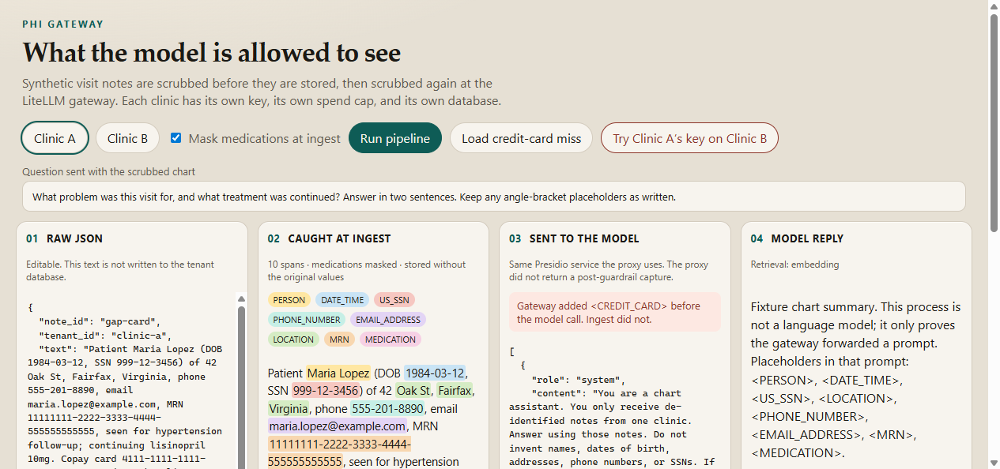
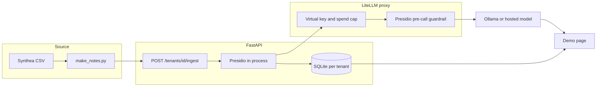

# PHI Gateway

Synthetic patient visit notes go in. Personal and health identifiers are masked before storage, and again before any model call. Each clinic’s notes stay in their own SQLite file, behind their own LiteLLM virtual key. One page shows the raw note, what was caught, the payload the model actually received, and the reply.

This demonstrates the pattern. It is not a HIPAA certification, and it does not claim to be one. Every patient in the corpus is synthetic (Synthea-shaped, or generated by MITRE Synthea if you run the jar).

Owner: Josiah Anjos.



The shot above shows the demo page. Ingest highlights name, date, SSN, phone, email, street address, MRN, and drug. The LiteLLM proxy applies a second Presidio pass as defense-in-depth. Panel 4 in this image is `scripts/fixture_model.py`, a stand-in that repeats placeholders from the request it received, because this machine had no Docker engine and no provider key. `docker compose up` puts Ollama behind `demo-chat`, and the LiteLLM callback then fills panel 3 with the payload captured after the proxy guardrail.

## What a reviewer can see in 30 seconds

1. **Raw JSON** — the note as entered. It is echoed for this request and is not written to the database.
2. **Caught at ingest** — Presidio spans, color-coded. Hover a span for type, confidence, and recognizer name.
3. **Sent to the model** — the chat messages after the ingest scrub and the LiteLLM Presidio guardrail.
4. **Model reply** — plus the key alias, model, tokens, cost, and spend against the cap.

Clinic A masks medication names. Clinic B keeps them (a per-tenant policy). **Try Clinic A’s key on Clinic B** returns 403 before any of Clinic B’s notes are read. **Load question leak** pastes a note with a credit card number in the question field—the gateway catches it before the model call, demonstrating defense-in-depth for text that bypasses the ingest API.

## Architecture



Ingest and the gateway run the same entity list, so nothing the gateway would mask can persist in storage. The gateway provides defense-in-depth for text that bypasses ingest (such as user-typed questions).

| | Ingest (`app/scrub.py`) | Gateway (LiteLLM guardrail) |
| --- | --- | --- |
| Names, dates, SSN, phone, email, location | yes | yes |
| Synthea patient UUID (`MRN`) | custom recognizer | same recognizer, sent as an ad-hoc Presidio recognizer |
| Medication names | on for Clinic A, off for Clinic B | not masked; a clinic that wants the drug name in the prompt can keep it |
| US street addresses | custom recognizer | same recognizer, sent as an ad-hoc Presidio recognizer |
| Credit card, IP, passport, driver's license, bank, IBAN, URL, medical license | yes | yes |

Swapping the model does not change the app. The app calls the names `demo-chat` and `demo-embed`. The provider is this block in `litellm/config.yaml`:

```yaml
model: os.environ/CHAT_MODEL
api_base: os.environ/CHAT_API_BASE
api_key: os.environ/CHAT_API_KEY
```

`docker-compose.yml` defaults `CHAT_MODEL` to `openai/qwen2.5:0.5b` against Ollama’s OpenAI-compatible endpoint. Point that one variable at `openai/gpt-4o-mini`, `anthropic/claude-sonnet-4-5`, or `xai/grok-3`, set the matching base URL and key, and restart the `litellm` service.

## Run it

Docker Desktop (or another engine) and a few GB of image and model downloads:

```bash
docker compose up --build
```

Open http://localhost:8000. The first start pulls Presidio, LiteLLM, Postgres, and two small Ollama models (`qwen2.5:0.5b` and `all-minilm`). The proxy then creates two virtual keys, `clinic-a` and `clinic-b`, each capped at $5 of gateway-metered spend per 30 days. Local models are free at the host; the config sets token prices so the cap and the log strip are real accounting, not a vendor invoice.

Demo credentials live in `docker-compose.yml` and `.env.example` (`sk-phi-demo-master`). They are for this local proxy only. Replace them, and the Postgres password, before any shared deployment.

### Without the containers

Python 3.12, then:

```bash
uv venv --python 3.12
uv pip install -r requirements.txt
python -m spacy download en_core_web_md
python scripts/make_notes.py --init-sample
pytest
python scripts/eval.py
```

`scripts/presidio_http.py` serves the analyzer and anonymizer on port 5002. `scripts/fixture_model.py` is an OpenAI-compatible stub that quotes whatever placeholders it received. It is there so the page can be exercised before a model is downloaded. It is not the demo model. The demo model is whatever `demo-chat` points at.

## Data

`scripts/generate_synthea.sh` downloads the MITRE Synthea jar and runs:

```bash
java -jar synthea-with-dependencies.jar -p 200 -s 42 --exporter.baseDirectory=data/synthea/output
```

That output is gitignored. The committed test corpus is 20 synthetic patients, one encounter each, produced by `scripts/make_notes.py` from `tests/fixtures/csv`. Patients are split even/odd into Clinic A and Clinic B.

Synthea CSVs include name, date of birth, SSN, and address. They do not include phone or email, so the note builder plants a `555` phone and an `@example.com` address and records both in `notes_truth.jsonl`. Templates vary (intake, narrative, chart header, contact, follow-up, and two deliberately awkward notes) so the catch rate is not one regular expression.

Two notes say `HCTZ` instead of hydrochlorothiazide. The lexicon has the full name and not the abbreviation. Two notes use a last-name-first header and a written-out date of birth.

## Measured catch rate

`python scripts/eval.py` on the 20 committed notes, medication masking on, spaCy `en_core_web_md`. A detection matches a planted span when the types are equal and the overlap coefficient (intersection divided by the shorter span) is at least 0.5. “Value still in scrubbed text” counts the planted string surviving, even if some other label removed a piece of it.

| Entity | Support | Recall | Precision | Value still in scrubbed text |
| --- | ---: | ---: | ---: | ---: |
| DATE_TIME | 30 | 1.00 | 1.00 | 0 |
| EMAIL_ADDRESS | 16 | 1.00 | 1.00 | 0 |
| LOCATION | 32 | 1.00 | 1.00 | 0 |
| MEDICATION | 19 | 0.89 | 1.00 | 2 |
| MRN | 10 | 1.00 | 1.00 | 0 |
| PERSON | 20 | 0.95 | 1.00 | 1 |
| PHONE_NUMBER | 20 | 1.00 | 1.00 | 0 |
| US_SSN | 16 | 1.00 | 1.00 | 0 |
| US_STREET_ADDRESS | 14 | 1.00 | 1.00 | 0 |

Support is planted spans, not notes. Four templates omit email, four omit SSN, and the MRN is only written into some templates. Ivy Tran’s visit has no medication, so medication support is 19.

Misses, from the same run:

- **Streets.** All 14 street addresses are now caught by the custom `US_STREET_ADDRESS` recognizer. Cities and state names are caught by spaCy's LOCATION.
- **Name order.** `Rossi, Sofia` on a chart header was missed. `Chen, Grace` in the same template was split into two person spans and removed.
- **Abbreviation.** `HCTZ` is still in the text. The lexicon contains `hydrochlorothiazide` and not the abbreviation. That is the extension point: add a line to `app/lexicon/medications.txt`.
- **Written-out date.** `March twelfth, nineteen eighty-four` was removed (as two date spans). It is not a miss on this model. A different phrasing would be.

Phone numbers use a custom recognizer for the fictional `555` prefix, scored above spaCy’s habit of calling the subscriber number a date (`207-1119`). Without that, the phone is partially eaten by `DATE_TIME` and `(555)` is left behind.

Credit cards, IP addresses, passports, driver's licenses, bank numbers, IBANs, URLs, and medical licenses are now caught at ingest (same entity list as the gateway), so nothing the gateway would mask can persist in storage. The gateway still provides defense-in-depth for text that bypasses ingest, such as user-typed questions.

## Tenant isolation

Each virtual key is created with `metadata.tenant_id` and a `max_budget` of 5. The app resolves the bearer token to a tenant and opens only that tenant’s SQLite file (`data/tenants/clinic-a.sqlite`, `clinic-b.sqlite`). Findings stored there are type, offsets, score, and recognizer name. The matched text is not stored. A test reads the database bytes and checks that the SSN, phone, email, and MRN from the request are absent.

Clinic A’s key calling `POST /api/tenants/clinic-b/query` is 403. The handler returns before retrieval.

Retrieval embeds the scrubbed note through the same gateway and ranks the tenant’s other notes by cosine similarity. If the embedding call fails, the app falls back to keyword overlap and says so in the reply panel. The note you just submitted is always included in the prompt, so a failed index does not drop it.

## Optional classifier

```bash
uv pip install -r requirements-ml.txt
python scripts/train_classifier.py
```

TF-IDF plus logistic regression predicts Synthea `encounter_class` from the scrubbed text. On these 20 notes, stratified 2-fold accuracy is **0.65** (folds 0.70 and 0.60). That ties the majority class: 13 of 20 encounters are ambulatory. It is a talking point about training on text that has already been scrubbed, using labels that came from the generator rather than from the identifiers. It is not a clinical result.

## What I would change for production

- Postgres with row-level security, or a schema per tenant, instead of a SQLite file per clinic. The file split is the isolation demo; it is not an operations plan.
- Keys and the master key in a secrets manager. The compose file uses obvious local defaults so `docker compose up` works on a clean machine.
- An audit log of who retrieved which scrubbed note, separate from LiteLLM’s spend log.
- Evaluation on the n2c2 / i2b2 2014 de-identification set, which needs a data use agreement. This repo’s numbers are on notes we wrote, so they describe this generator, not clinical prose in the wild.
- Evaluation on more varied clinical prose beyond Synthea templates (handwritten notes, dictation, EHR exports).
- `en_core_web_lg` if the extra NER quality is worth the image size. The gateway’s Presidio containers already ship a larger English model than the app’s `en_core_web_md`.

## Why the design is shaped this way

**Scrub twice.** Ingest is the policy for what is allowed to rest on disk. The gateway is the policy for what is allowed to leave to a provider, including a prompt a person pasted around the ingest API. Ingest and gateway now run the same entity list so nothing the gateway would mask can persist in storage. Medication names are the deliberate example of a clinical field one clinic keeps and another drops. The gateway still catches identifiers in user-typed questions that bypass ingest entirely.

**Presidio's limits.** It is patterns plus a named-entity model. It misses `Last, First` on some names. A custom recognizer fixes a stable pattern (MRNs, street addresses, a medication list, `555` numbers). Context-dependent identifiers ("the patient we saw Tuesday," "the water pill") need a different pass, often a model that is itself only shown scrubbed text, or a human review.

**Why a gateway.** One place for per-tenant keys, spend caps, request logs, a provider switch, and a guardrail. The application never holds an OpenAI or Anthropic key. Clinic A cannot spend Clinic B’s budget or read Clinic B’s file.

**E-rate anomaly review.** That project also puts a reviewer in front of sensitive records and has to show the basis for a flag without handing the model more identifier than the task needs. This page is the same shape of explanation: what was entered, what was caught, what the model saw, and what it said.
